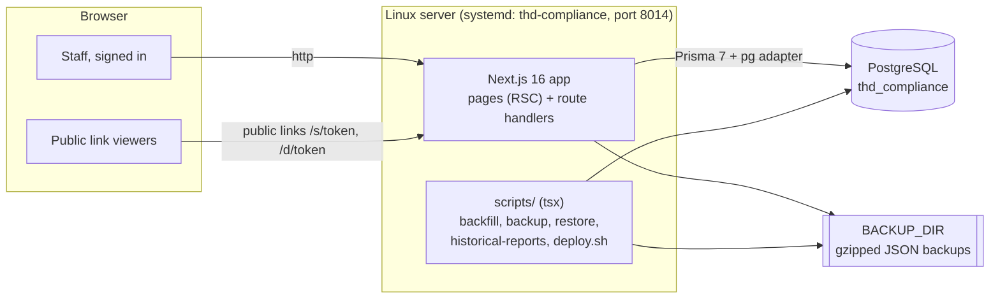
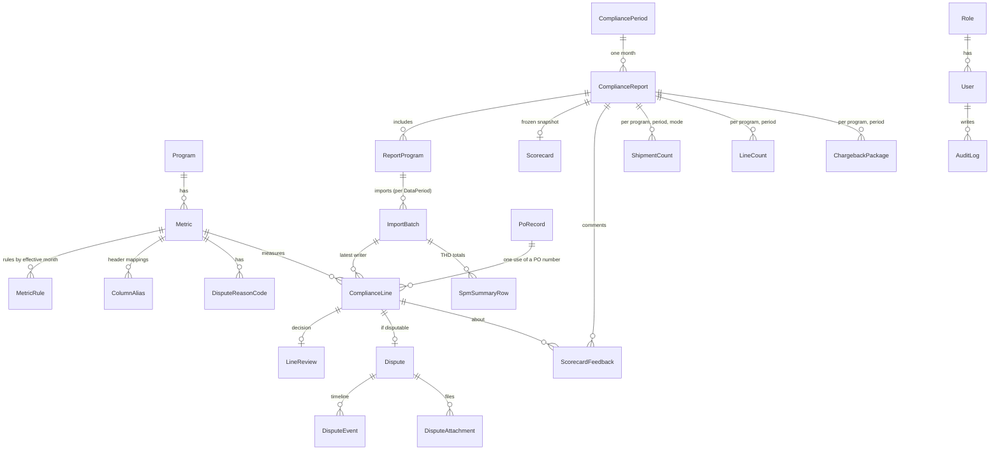
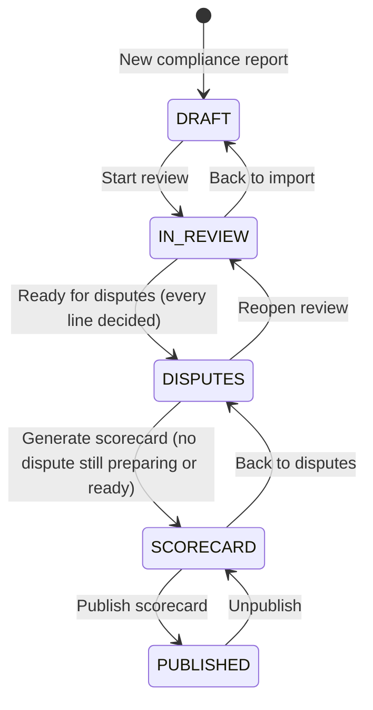
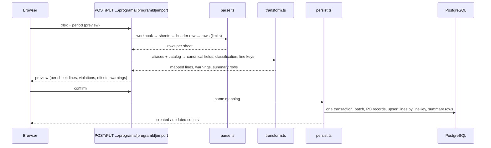
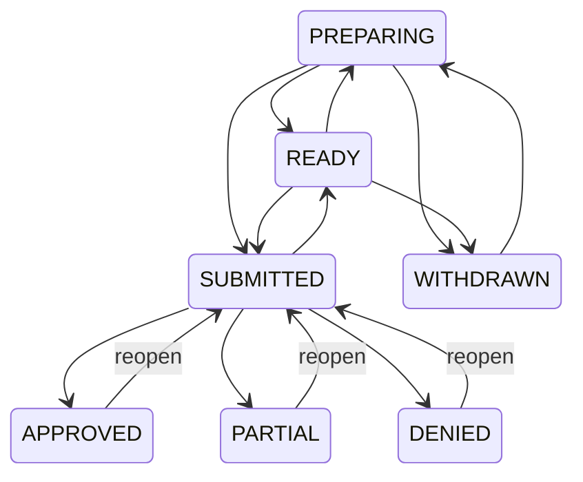

# Sympl CM: Technical Design Document

| | |
|---|---|
| **System** | Sympl CM, THD Compliance Management Platform (the default brand; admins can rename it) |
| **Organisation** | JS Products (THD P-Vendor 875062) |
| **Document status** | Current, describes the system as built |
| **Last updated** | October 2026 |
| **Related documents** | `README.md` (features and setup), `CLAUDE.md` (conventions for contributors), `docs/design-system.md` (Sympl UI), in-app **Help & Docs** (`/help`, user guide) |

---

## 1. Purpose and scope

### 1.1 Purpose

This document describes how the platform is built: its architecture, data model, main flows, the rules behind the compliance figures, security, deployment and operations. It is written for engineers who maintain or extend the system and for anyone reviewing its design. User-facing instructions are in the in-app Help & Docs; the feature list is in the README.

### 1.2 Problem

Each month JS Products receives compliance results from The Home Depot (THD) through SPM (Supplier Performance Management, supplierhub.homedepot.com): one Excel export per compliance program, one sheet per metric. These were analysed by hand in a 13-sheet workbook: violations reviewed line by line, disputes prepared and tracked, offsets (chargebacks) totalled, a scorecard assembled and circulated. The process was slow, hard to audit, and kept no searchable history of POs.

### 1.3 Goals

- Import SPM exports as they are, tolerating THD's changing column names and quirks, and keep every line, compliant or not, as a searchable PO history.
- Guide the monthly workflow: import → review every violation → dispute → scorecard → publish.
- Calculate compliance and offsets the way THD does, before and after disputes, and freeze published results.
- Share results with people without accounts (public scorecards and dashboard) and collect warehouse feedback.
- Give finance a way to match THD's chargeback packages to POs.
- Run on one internal Linux server, with backups and a one-command update.

### 1.4 Non-goals

- Pulling data from SPM automatically. THD offers no API; exports are downloaded by hand.
- Submitting disputes to SPM. The platform prepares them; people submit them in SPM and record THD's decision.
- Multi-tenant use. One supplier, one database.
- Internet exposure. The server is reached on the internal network over plain http (see §9.6).

---

## 2. Context

### 2.1 Domain

| Concept | Meaning |
|---|---|
| **Program** | A THD compliance program: US Drop Ship, US RDC, US DFC, US Transportation, Data Quality Compliance (DQC), Invoice Timeliness. |
| **Metric** | A measure within a program (Fill Rate, On Time, Missing ASN, Late ASN, TMS Utilization, Routing Guide, Parcel PO, …), with a goal and an offset rule. |
| **Offset** | THD's charge for a violation: a flat amount per violation, or a percentage of the goods' value. |
| **Fiscal month** | THD's month as `YYYYMM`, month `01` = February (`src/lib/fiscal.ts`). FM 202605 is June 2026. |
| **Compliance period** | THD reports Fill Rate and On Time two months behind the other metrics, so each report has two periods: `FILL_ON_TIME` and `OTHER` (`DataPeriod`). |
| **Report period** | The month a report covers. Lines are grouped by the month they were received (default) or by THD fiscal month (`SiteSettings.reportPeriodBasis`). |
| **Package ID** | THD's reference for a batch of chargebacks, shown on the remittance; entered by hand. |

### 2.2 Users and roles

| Role | Purpose | Permissions |
|---|---|---|
| Admin | Everything (always has every permission, including ones added later) | all |
| Analyst | Runs the monthly workflow | `view.dashboard`, `view.polookup`, `reports.*`, `lines.triage`, `disputes.manage`, `feedback.view`, `feedback.submit`, `summarizer.use` |
| Viewer | Read-only results | `view.dashboard`, `view.polookup` |
| Warehouse | Comments on published violations | `feedback.view`, `feedback.submit` |
| Finance | Read-only lookup and summaries, chargeback packages | `view.polookup`, `feedback.view`, `summarizer.use` |

Admins can create further roles. Permissions are listed in `src/lib/permissions.ts`.

### 2.3 External interfaces

| Interface | Direction | Notes |
|---|---|---|
| SPM xlsx exports | In (manual upload) | One file per program; `…_ALL_RESULTS_…`, `…_NON_COMPLIANT_…`, `…_SUM_…`, `US_INVOICE_TIMELINESS_RECORDS_…` |
| SPM disputes | Out (manual) | The platform produces the comment and document checklist; people submit in SPM |
| THD remittance | In (manual) | Package IDs typed onto reports; looked up by finance |
| Browsers on the internal network | Both | Staff (signed in) and recipients of public links (no sign-in) |

---

## 3. Architecture

### 3.1 Overview

A single Next.js application serves the pages and the JSON/file API, and talks to one PostgreSQL database. There are no other services, queues or caches. Generated files (PDF, Excel) are built per request; uploads (dispute attachments, logo) are stored in the database.



### 3.2 Technology stack

| Layer | Choice | Notes |
|---|---|---|
| Framework | Next.js 16 (App Router, Turbopack), React 19, TypeScript 5 | Server components for pages; client components only where interactive. Route handlers under `src/app/api`. |
| Database | PostgreSQL, Prisma 7 with `@prisma/adapter-pg` | Schema in `prisma/schema.prisma`; 22 hand-reviewed migrations. |
| Auth | NextAuth v5, credentials provider, bcrypt, JWT sessions | §9.1 |
| UI | Tailwind CSS v4, Radix UI primitives, class-variance-authority, Lucide icons, Geist | "Sympl UI" design system (`docs/design-system.md`). |
| Validation | zod | Every request body is parsed and trimmed at the route boundary. |
| Excel | ExcelJS | Parsing uploads (with size, row and column limits) and writing exports. |
| PDF | pdfkit | Scorecard and Summarizer PDFs, server-side. |
| Tests | Vitest | Unit tests with real SPM export fixtures. |
| Scripts | tsx | Command-line tools sharing the app's library code. |

`exceljs`, `pdfkit`, `pg` and Prisma are server-external packages (`next.config.ts`), loaded from `node_modules` at runtime rather than bundled.

### 3.3 Code organisation

```
src/
  app/
    (app)/              signed-in pages, wrapped by AppShell (sidebar)
      dashboard/ reports/ disputes/ scorecards/ po-lookup/ po/ feedback/ summarizer/ help/ admin/
    s/[token]/          public scorecard
    d/[token]/          public dashboard
    login/
    api/                route handlers (only HTTP-method exports)
  components/
    ui/                 design-system primitives
    layout/             AppShell, Sidebar, BrandMark
    scorecard/ dashboard/ shared/
  lib/                  domain logic (most of it pure and unit-tested)
    import/             parse → transform → persist, catalog of programs and rules
prisma/                 schema, migrations, seed
scripts/                backfill, backup, restore, historical-reports, deploy.sh
tests/                  Vitest tests and fixtures
docs/                   design system, this document
reference/              THD reference PDFs, the historical archive, exports received later
```

Domain logic lives in `src/lib`, kept free of React so pages, route handlers and scripts share it. Calculation rules that matter for correctness are pure functions in database-free modules (`scorecard-rules.ts`, `summarizer.ts`, `import/transform.ts`, `package-id.ts`, `shipment-ranges.ts`) so they can be unit-tested and used in client components.

---

## 4. Data model

### 4.1 Entities



| Model | Purpose and key fields |
|---|---|
| `Program`, `Metric` | Programs (`code` e.g. `US_DS`, `filePrefix`) and their metrics (`code`, `sheetNames`). Seeded from `src/lib/import/catalog.ts`, edited by admins afterwards. |
| `MetricRule` | Goal and offset per metric with `effectiveFrom` (fiscal month); the rule in force is the latest one on or before the period (`ruleFor`). `offsetType`: `NONE`, `FLAT`, `PCT_VALUE`. |
| `ColumnAlias` | Export header → canonical field, optionally scoped to a program or metric. How drifting THD headers are mapped. |
| `DisputeReasonCode` | THD's dispute matrix per metric: when to use, required documents. |
| `CompliancePeriod` | A fiscal month, with its SPM dispute window. |
| `ComplianceReport` | One month's report: `status` (`DRAFT` → `IN_REVIEW` → `DISPUTES` → `SCORECARD` → `PUBLISHED`), `historical`, shipment date ranges per period. |
| `ReportProgram` | A program in a report, with import status. |
| `ImportBatch` | One imported file: `sha256`, `exportKind`, `period` (`DataPeriod`), counts, warnings. |
| `SpmSummaryRow` | THD's own Summary sheet totals, for reconciliation. |
| `ComplianceLine` | One SPM row: `lineKey` (unique), `metricId`, `fiscalMonth`, `receivedMonth`, `isCompliant`, `offsetAmount`, ~40 canonical typed fields (PO, SKU, quantities, dates, shipment references, THD status and decision), and `raw` (every source column). `batchId` is the latest import to write it, `createdBatchId` the one that created it. |
| `PoRecord` | One use of a PO number, keyed by `instanceKey` (§4.2). |
| `LineReview` | The decision on a non-compliant line (`Disposition`), team influence, root cause, notes, extra research fields. |
| `Dispute`, `DisputeEvent`, `DisputeAttachment` | One dispute per disputable line: status, reason code, checklist, amounts, THD decision; its timeline; its files (stored as bytes). |
| `Scorecard` | `data` (JSON snapshot), version, generated/published by and when, `shareToken`. |
| `ScorecardFeedback` | A comment on a published violation, keyed by report and line. |
| `ShipmentCount`, `LineCount`, `ChargebackPackage` | Manual inputs per report, program and compliance period: shipments by mode, line totals (§6.4), the chargeback Package ID (§5.8). |
| `SiteSettings` | Single row (`id = "site"`): branding and logo, `reportPeriodBasis`, `publicDashboardToken`. |
| `User`, `Role`, `AuditLog` | Accounts (bcrypt hash, active flag), roles with permission lists, audit trail of changes. |

### 4.2 Identity rules

- **Line identity (`ComplianceLine.lineKey`).** A hash of the metric, fiscal month and the line's shipment identifiers (PO, SKU, vendor SKU, ASN doc trace ID, TMS ID, PRO, OMS ID, customer order, tracking #, shipment #, BOL #, reason), plus an occurrence number for true duplicates (`transform.ts`). Re-importing the same or a newer export updates lines in place instead of duplicating them.
- **PO identity (`PoRecord.instanceKey`).** THD reuses PO numbers, so a record is one use of a number: `poNumber|YYYY-MM-DD` (PO create date). Lines without a create date join the nearest use by ship or check-in date (`pickPoInstance` in `src/lib/po.ts`). A PO record is never looked up by number alone.
- **Received month.** Each line keeps the month it was first imported into (or its archive folder); it is never earlier than its fiscal month, and a later export never moves it.

### 4.3 Snapshots

`Scorecard.data` is a JSON snapshot (`ScorecardData` in `src/lib/scorecard.ts`) of everything the scorecard shows: per-program and per-metric results, totals, violations, shipments, team influence and the 12-month trend. Pages and downloads render the snapshot, never live data, so a published scorecard cannot shift when lines, reviews or rules change. Two things are deliberately read live on top of it:

- **Feedback** (`withFeedback`): attached to the snapshot's violations by `lineId` each time it is shown or downloaded.
- **Awaiting THD decision** in the Summarizer: current dispute status by `lineId`.

Fields added to the snapshot over time are optional, so older snapshots keep rendering (for example `lineId`, `rootCause`, per-period shipment counts).

---

## 5. Main flows

### 5.1 Report lifecycle



Moves are validated on the server by `PATCH /api/reports/[id]` (`reports.advance`), which refuses `DISPUTES` while any non-compliant line is undecided or needs research, and `SCORECARD` while any dispute is still preparing or ready. Entering `DISPUTES` creates disputes from Disputable reviews (`dispute-sync.ts`); entering `SCORECARD` generates the snapshot. Imports and purges are allowed in `DRAFT` and `IN_REVIEW`; line counts until published; Package IDs at any stage.

### 5.2 Import pipeline



- **Parse** (`parse.ts`): ExcelJS, at most 25 MB per file, 200 columns and 100,000 rows per sheet. Finds the header row, skips `RESULT DATA EMPTY` sheets, de-duplicates repeated headers.
- **Transform** (`transform.ts`, pure): maps headers to canonical fields through `ColumnAlias` (never by column position), coerces dates and numbers (`values.ts`), classifies each line (`classifyLine`), builds line keys, and handles known export quirks (the US Transportation offset shifted under "Department #", typed notes and subtotal rows, Fill Rate as a percent or a fraction). Unknown columns are kept in `raw` and reported.
- **Classification.** A line is non-compliant when the export is `NON_COMPLIANT`, the metric is a violation list (Invoice Timeliness), it carries an offset, THD's status says so, or the metric's own test fails (Fill Rate short-shipped or cancelled, On Time late, legacy ASN after check-in). Full-population sheets (Fill Rate, On Time) otherwise count as compliant; other sheets count as compliant only when they show a $0 offset.
- **Compliance periods.** Each report program has one import per `DataPeriod`. Sheets belonging to the other period are **update-only**: they refresh existing lines (so THD's later decisions arrive) but never create lines, so a violation cannot count in two reports.
- **Summary-only exports** (`…_SUM_…`): each metric with offsets becomes one PO-less line (`sourceSheet = SUMMARY_SHEET`); detail lines for the same metric and month replace it.
- **Idempotence.** Files are fingerprinted (SHA-256), and lines are upserted by `lineKey`, so re-importing is safe.
- **Purge** (`purge.ts`): deletes one period's imports for a program and only the lines those imports created (`createdBatchId`), with their reviews and disputes; lines that existed before are kept and pointed back at the import that created them.

### 5.3 Review and disputes

Every non-compliant line gets a `LineReview`: decision, team influence, root cause, notes and research fields (`PUT /api/lines/[id]/review`, `lines.triage`). `Cancelled / Resolved` marks a line that is not a real violation (§6.1).

Disputes follow a fixed state machine (`canTransition`):



A dispute carries its reason code, a document checklist from the dispute matrix, attachments (10 MB each, allow-listed extensions), the SPM comment, the dispute window deadline, amounts disputed and recovered, and THD's decision code. Outcomes are recorded by people; an Approve/Deny value found in a later export only flags the dispute (`spmDecisionSeen`). **Sync from review** reconciles disputes with changed reviews.

### 5.4 Scorecards and sharing

`buildScorecard` (`scorecard.ts`) gathers the metric statistics (§6), violations with their reviews and disputes, shipment counts and ranges, team influence and a 12-month trend, and `scorecard-store.ts` saves it as a new snapshot version. It can be regenerated only in `SCORECARD`. Downloads are generated per request: PDF (`scorecard-pdf.ts`) and Excel (`scorecard-export.ts`).

Published scorecards get an unguessable `shareToken` (24 random bytes, base64url) on first view. `/s/<token>` and `/api/s/<token>/{pdf,export}` need no sign-in and check that the report is still published; unpublishing takes the page down and republishing brings the same link back.

### 5.5 Scorecard Feedback

`ScorecardFeedback` rows attach to a published report and a violation's line. The feedback module lists published scorecards and their violations; feedback is merged into scorecard pages, PDF and Excel at render time (`withFeedback`), so new comments appear without regenerating. Authors delete their own; user admins can delete any.

### 5.6 Dashboards

`src/lib/dashboard.ts` provides the 12-month offsets by program, the rolling 12-month total over all history (with month-over-month change) and the recent published reports; `dashboard-sections.tsx` renders them for both the internal dashboard and the public one. The public dashboard (`/d/<token>`) is off unless `SiteSettings.publicDashboardToken` is set; admins turn it on, issue a new token, or turn it off. It omits work in progress, though its offset totals use all imported lines.

### 5.7 Summarizer

`/summarizer?r=<ids>` rolls selected published scorecards into one summary (`buildSummary`, pure): totals, per-report figures with links to public scorecards, violations grouped by program and metric with PO, offset and team, totals by team, and the amount awaiting THD's decision (disputes currently `SUBMITTED`, read live by line). `/api/summarizer/pdf` renders it with its own PDF layout helpers (`summary-pdf-layout.ts`), independent of the scorecard PDF.

### 5.8 PO Lookup, PO records and chargeback packages

PO Lookup searches lines by PO prefix and exact shipment identifiers, grouped by PO record; each PO record page (`po-record.ts`) assembles everything known about one use of a PO. Chargeback packages are `ChargebackPackage` rows (report × program × period → Package ID, validated by `normalizePackageId`). A package covers that slot's lines with an offset; `/po-lookup/package/<id>` lists them with decision, dispute, recovered and net amounts, and `/api/po-lookup/package/<id>/export` writes the same as xlsx (`package-export.ts`). Matching is case-insensitive; the same ID on several slots is shown as one package.

### 5.9 Historical reports

`historical.ts` (also `npm run historical-reports` and the **Historical reports** dialog) creates a published, auto-reviewed report for each archived month without one, leaving the current and previous month to the normal workflow. Violations are accepted as THD reported them; per-line Approve/Deny values become decided disputes; THD's Summary post-dispute totals are used where they reconcile, marked "per THD". `--rebuild` regenerates them after a rule or setting change.

---

## 6. Calculation rules

All per-metric figures come from `getMetricStats(programIds, month, lineCounts)` in `src/lib/reports.ts`, using pure helpers in `src/lib/scorecard-rules.ts`. Lines are selected with `linesInPeriod(await getPeriodField(), month)` so the report period setting is respected everywhere.

### 6.1 Compliance percentage

Pre-dispute counts Cancelled / Resolved lines as compliant; post-dispute also counts approved disputes ("cleared" lines).

| Metric kind | Denominator | Formula |
|---|---|---|
| Fill Rate with quantities (RDC, DFC) | units ordered | (units received + shortfall of cleared lines) ÷ units ordered |
| **US Drop Ship Fill Rate** | lines closed = shipped (On Time lines) + cancelled (Fill Rate lines) | (shipped + cleared) ÷ closed (`dropShipFillRatePct`), THD's definition; its Fill Rate sheet lists only cancellations |
| Other metrics with compliant lines in the export | lines in the export | (compliant + cleared) ÷ all lines |
| Export lists only violations, line count entered | `LineCount` for the program and period | (lines − violations + cleared) ÷ lines (`enteredLinesPct`), marked `linesSource: "ENTERED"` |
| DQC, Invoice Timeliness (`PASS_FAIL_PROGRAMS`) | none | 100% when no violation stands, otherwise no percentage (`passFailPct`) |
| Anything else without a denominator | none | no percentage |

The export's own population always takes precedence over an entered line count.

### 6.2 Result against goal

`meetsGoal` compares the post-dispute percentage with the rule's goal. Without a percentage it falls back to: a percentage-of-value metric is **Below goal** while a post-dispute offset remains (THD only charges it below goal); any other metric is **Below goal** while an uncleared violation remains; otherwise no result.

### 6.3 Offsets

- Pre-dispute offset = THD's offsets on the period's lines.
- Post-dispute offset = pre-dispute − recovered (approved and partially approved disputes) − offsets on Cancelled / Resolved lines.
- A **percentage-of-value** offset falls away entirely after disputes only when THD's own rate was below the goal and the post-dispute rate reaches it (`pctOffsetFallsAway`). If THD charged it while its own rate already met the goal, it stays owed until disputed, rather than silently becoming $0.
- Pending, denied and disputed amounts come from the disputes' statuses and amounts.

### 6.4 Periods and lags

Fill Rate and On Time data is two fiscal months behind (`FILL_ON_TIME_LAG_MONTHS = 2`). When grouping by month received, a report's On-Time & Fill Rate import expects THD's data from two months earlier, and Drop Ship lines (which carry no fiscal month) take that month.

---

## 7. API surface

All route handlers check the session and then a permission (`requireApiPermission`), parse bodies with zod (`parseJson`), and write an `AuditLog` entry for changes. Pages use `requirePagePermission`, which redirects to the sign-in page or to the user's first permitted page (`homePath`).

| Area | Routes | Permission |
|---|---|---|
| Reports | `POST /api/reports` (`reports.create`); `PATCH /api/reports/[id]` (stage moves `reports.advance`, other edits `reports.create`); `GET`/`POST /api/reports/historical` (`reports.advance`) | as shown |
| Imports | `POST`/`PUT /api/reports/[id]/programs/[programId]/import` (preview, confirm), `…/purge` | `reports.import` |
| Report inputs | `PUT /api/reports/[id]/shipments`, `/line-counts`, `/package-ids` | `reports.import` |
| Review | `PUT /api/lines/[id]/review` | `lines.triage` |
| Disputes | `/api/disputes/[id]` (status, fields), `/events`, `/attachments`, `/attachments/[attachmentId]`; `POST /api/reports/[id]/disputes/sync`; `PATCH /api/periods/[id]` (dispute window) | `disputes.manage` (downloads `reports.view`) |
| Scorecards | `/api/reports/[id]/scorecard` (regenerate), `/pdf`, `/export` | `reports.advance`; downloads `reports.view` or `view.dashboard` once published |
| Public | `/api/s/[token]/pdf`, `/export`; pages `/s/[token]`, `/d/[token]` | token only |
| Feedback | `POST /api/feedback`, `DELETE /api/feedback/[id]` | `feedback.submit` |
| Summarizer | `GET /api/summarizer/pdf?r=…` | `summarizer.use` |
| PO Lookup | `GET /api/po-lookup/package/[packageId]/export` | `view.polookup` |
| Admin | `/api/admin/users`, `/roles`, `/aliases`, `/metrics/[id]` (+ `/rules`, `/reason-codes`), `/rules/[id]`, `/reason-codes/[id]`, `/settings/{branding,report-periods,public-dashboard}`, `/backups` (+ `/[name]`, `/restore`) | the matching `admin.*` permission |
| Other | `/api/auth/[...nextauth]`, `GET /api/branding/logo` | — |

---

## 8. Front end

- **Rendering.** Pages are React server components that query through `src/lib` directly; client components handle forms, dialogs, the review workspace, charts and copy buttons, calling the API with `apiFetch`.
- **Design system.** Sympl UI (`docs/design-system.md`): gray-900 sidebar with blue-600 active item, gray-50 content, white cards with gray-200 borders, shared primitives in `src/components/ui`. Forms use the Input, Select and Textarea components; dialogs use `DialogContent`; badges use semantic variants.
- **Navigation.** The sidebar shows only what the role allows; Help & Docs is open to everyone.
- **Charts.** The rolling-offsets chart is hand-written SVG with hover, keyboard navigation and a table view; no chart library.
- **Plain-http clipboard.** The Clipboard API exists only on secure origins, so `copyText` (`src/lib/clipboard.ts`) falls back to a selection copy.
- **Branding.** Never hard-coded: `getBranding()` and `BrandMark`; pages shown before sign-in call `connection()` to render per request.
- **Help content** is data (`src/lib/help-content.ts`), filtered by role and searchable; it must be updated when screens or rules change.

---

## 9. Security

### 9.1 Authentication

NextAuth v5 credentials provider: email and password checked against a bcrypt hash; inactive users cannot sign in; `lastLoginAt` is recorded. Sessions are signed JWTs (`AUTH_SECRET`) carrying the user id and role name. Admins set temporary passwords; there is no self-service reset or e-mail.

### 9.2 Authorisation

Permissions are re-read from the database on every request (`getCurrentUser`, cached per request), so a role change applies immediately rather than at the next sign-in. Every page and route handler checks a specific permission. Links to pages a role can't open are hidden in the UI, but the server check is what enforces access.

### 9.3 Public links

Public scorecards and the public dashboard are reachable by anyone who has the link. Tokens are 24 random bytes (base64url), validated by pattern before any database lookup; pages are marked `noindex`. Scorecard links stop working when the report is unpublished; the dashboard link can be replaced or turned off. Public scorecards include root causes, notes and warehouse feedback, which is a deliberate trade-off to keep in mind before sharing outside the company.

### 9.4 Input handling

- Request bodies: zod schemas with trimming, length and range limits.
- Uploads: SPM files 25 MB, 200 columns and 100,000 rows per sheet; dispute attachments 10 MB with an extension allow-list; backups up to 500 MB, restored only at the same schema migration and only after typing RESTORE.
- Identifiers from URLs (tokens, report ids, Package IDs) are pattern-checked before use.
- Spreadsheet cell values are stored as data and never evaluated; generated Excel files contain values, not formulas from input.

### 9.5 Audit

Changes through the API write `AuditLog` rows (user, action, entity, id, details): reviews, disputes, report moves, imports and purges, settings, users and roles, line counts, Package IDs, backups.

### 9.6 Deployment boundary

The server is reached over plain http on the internal network, not exposed to the internet. Credentials and session cookies therefore travel unencrypted on that network. Putting a TLS-terminating reverse proxy in front (and setting the auth URL accordingly) is the recommended next step if the network is not trusted or access widens.

### 9.7 Secrets

`DATABASE_URL`, `AUTH_SECRET` and the seed admin credentials live in `.env` on the server, which is not in git. The application uses its own database user and database, separate from other applications on the server.

---

## 10. Deployment and operations

### 10.1 Runtime

| Item | Value |
|---|---|
| Host | One internal Linux server, app folder `~/jsproducts/thd-compliance`, run as the `jsadmin` user |
| Process | `next start` under the systemd service `thd-compliance`, port 8014 |
| Database | PostgreSQL database `thd_compliance`, user `thdcompliance` |
| Logs | systemd journal (`journalctl -u thd-compliance`) |

### 10.2 Updating

`./scripts/deploy.sh` (from the app folder):

1. Takes a lock (`.deploy.lock` with the deploy's process ID; a lock left by a killed deploy is cleared on the next run).
2. Refuses to continue if tracked files were edited on the server or the branch diverged.
3. Takes a pre-deploy backup (newest 10 kept).
4. Fast-forward pulls the branch, runs `npm ci`, `prisma migrate deploy`, `next build`.
5. Restarts the service and waits for the site to answer on the port.
6. On a failed build, restart or health check, puts the previous commit back, rebuilds and restarts it. Migrations are not reversed; the pre-deploy backup covers that.

Options: `--branch`, `--force`, `--skip-backup`, `--no-restart`; `SERVICE_NAME`, `PORT`, `BACKUP_KEEP`.

### 10.3 Database migrations

Migrations are generated with `prisma migrate diff` and reviewed by hand; data changes (for example splitting PO records by create date, adding roles or permissions to existing databases, rescaling Fill Rate fractions) are written into the same migration. PostgreSQL does not apply a Prisma migration in one transaction, so a failed migration is left partly applied and needs `prisma migrate resolve`; migrations are ordered so that failure points are safe (for example dropping a unique index before inserting rows that would violate it), and the larger ones were tested against a copy of the real data.

### 10.4 Backups and recovery

`src/lib/backup.ts` writes logical backups: every model in `TABLE_ORDER`, attachments included, as gzipped JSON, with the schema migration they were taken at. A test enforces that every model is in `TABLE_ORDER`.

- Manual: **Back up now** in Admin › Backup & Restore.
- Scheduled: `npm run backup -- --keep 30` from cron; `--label` keeps a separate set.
- Before each deploy: automatic.
- Restore: from the admin page or `npm run restore -- <file> --yes`; one transaction, after a safety backup, refused if the schema migration differs.

### 10.5 Data loading

- `npm run backfill -- <dir>` imports a folder of historical SPM exports (oldest first, skipping files already imported and non-SPM files; folder names supply the month for Drop Ship).
- `npm run historical-reports` creates historical reports (§5.9).
- `npm run db:seed` creates roles, the first admin, programs, metrics, rules, column mappings and fiscal periods.

---

## 11. Testing and quality

| Check | How |
|---|---|
| Lint | `npm run lint` (ESLint with Next.js rules, including `react-hooks/set-state-in-effect`) |
| Types | `npm run typecheck` (strict TypeScript) |
| Unit tests | `npm test` (Vitest, 74 tests): import transform against real SPM fixtures (DS, RDC, DFC, US Transportation quirks, summary-only, Fill Rate fractions, Invoice Timeliness), value parsing, catalog, scorecard rules (goals, Drop Ship Fill Rate, entered lines, pass/fail, offsets), shipment ranges, disputes, PO instance keys, permissions and landing pages, backups' table coverage, branding, Summarizer, Package IDs, help topics |
| Build | `npm run build` |
| End to end | Playwright scripts run against a local build during development (imports, review, disputes, scorecards, sharing, feedback, roles, Summarizer, packages, help) |
| Data checks | Backfill reconciled against the workbook's YTD Offset Report (73 of 85 month cells by month received); migrations tested on copies of the archive database |

---

## 12. Configuration

| Setting | Where | Purpose |
|---|---|---|
| `DATABASE_URL` | `.env` | PostgreSQL connection |
| `AUTH_SECRET` | `.env` | Signs session JWTs |
| `AUTH_TRUST_HOST` | `.env` | Required when self-hosted |
| `SEED_ADMIN_*` | `.env` | First admin, created by the seed |
| `BACKUP_DIR` | `.env` | Backup folder (default `./backups`) |
| `SERVICE_NAME`, `PORT`, `BACKUP_KEEP` | environment for `deploy.sh` | Deploy settings |
| Branding, report period basis, public dashboard | Admin › Settings (`SiteSettings`) | Runtime settings |
| Programs, metrics, rules, reason codes, column mappings | Admin › Programs & Rules | Domain configuration, seeded from `catalog.ts` |

---

## 13. Design decisions

| Decision | Reason | Consequence |
|---|---|---|
| One Next.js app, no separate API service | One small team, one server, no external clients | Simple deploys; domain logic shared through `src/lib` |
| Map export columns by header name through admin-editable aliases | THD's headers drift between months (30+ layouts in the archive) | New headers need no code change; every source column is still kept in `raw` |
| Keep every line, compliant or not | PO history and correct percentages need the full population | Larger tables (≈9,300 lines from the archive); search stays fast with indexes |
| Line identity by content hash, upsert on import | Re-imports and newer exports must not duplicate | Exports can be imported in any order and more than once |
| PO record = number + create date | THD reuses PO numbers | Lookups by number alone are forbidden in code |
| Two compliance periods per report, other period update-only | Fill Rate and On Time lag two months | A violation can't be counted twice; THD decisions still flow in |
| Frozen JSON scorecard snapshots | Published results must not move | Regeneration is explicit; live overlays only for feedback and dispute status |
| Group by month received by default | Matches the monthly workbooks and how data arrives | Configurable; historical reports can be rebuilt |
| Manual inputs (shipments, line counts, Package IDs) per report, program and period | The data isn't in the SPM exports | Same shape everywhere; a better source can replace them later |
| Logical JSON backups instead of `pg_dump` | No database tooling needed on the server; restorable from the UI | Restore requires the same schema migration |
| Server-side PDF and Excel | Consistent files, no browser printing | pdfkit's standard fonts limit the characters used in PDFs |
| Plain http on the internal network | Existing server and network | See §9.6 |

---

## 14. Risks, limitations and future work

| Item | Notes |
|---|---|
| THD changes an export's layout | Mitigated by header aliases and import warnings; a structural change (new sheet, new metric) needs a catalog or code update. |
| Manual inputs can be forgotten | Line counts, shipment counts and Package IDs are typed in; the report page shows what each is used for. A future import of these from TMS/WMS or THD's remittance would remove the step. |
| Percentages from entered line counts | One count per program and period serves every metric in that period; THD may count differently per metric. |
| Single server, single database | No high availability; recovery is from backups. Off-server copies of `BACKUP_DIR` are recommended. |
| Plain http | See §9.6. |
| No password reset by e-mail | Admins set passwords. |
| Public links | Anyone with a link can view; there is no expiry other than unpublishing or replacing the dashboard link. |
| Snapshot schema evolution | New snapshot fields must stay optional so older scorecards render. |
| Help content drift | Help is data in the repo and must be updated with UI or rule changes (noted in `CLAUDE.md`). |

Possible next steps: TLS in front of the app; scheduled off-server backups; importing line and shipment counts from TMS/WMS; reading Package IDs from THD's remittance file; e-mail notifications for dispute deadlines.

---

## 15. Glossary

See the Glossary topic in **Help & Docs** (`/help#glossary`) and §2.1.
